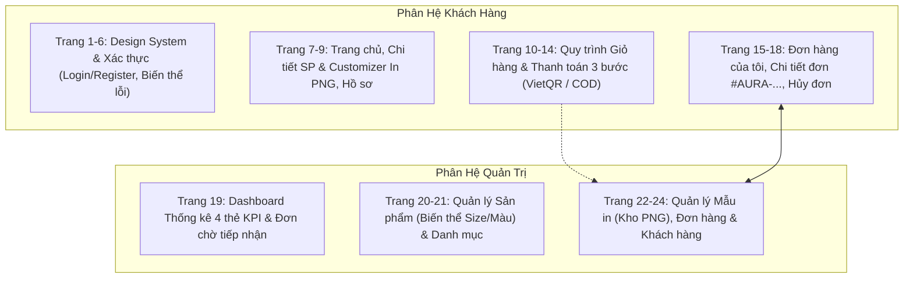
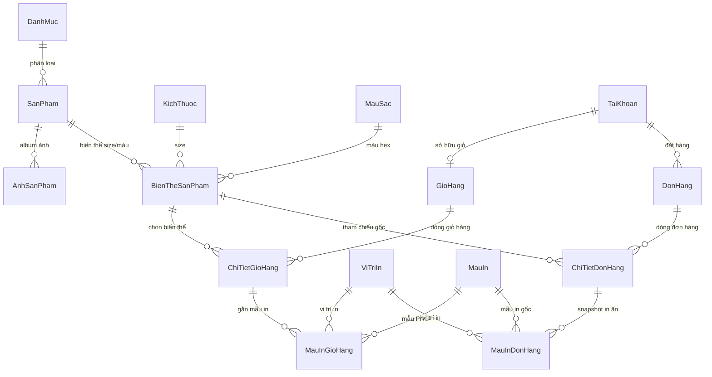
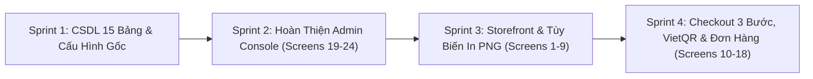

# BÁO CÁO PHÂN TÍCH THIẾT KẾ, GIAO DIỆN & DANH SÁCH TASK DỰ ÁN AURA FASHION

> **Căn cứ tài liệu**:
>
> - `docs/Chuong3_ThietKe.docx` (Chương 3: Thiết Kế Hệ Thống - CSDL & Mô Hình Xử Lý)
> - `docs/AURA.pdf` (Bộ Thiết Kế Giao Diện UI/UX Figma - 25 Màn Hình Chuẩn Hóa)
>
> **Dự án**: Website Thời Trang AURA In Theo Yêu Cầu
> **Ngày cập nhật**: 23/11/2026
> **Người lập**: Antigravity Agent

---

## MỤC LỤC

1. [TỔNG QUAN HỆ THỐNG & ĐẶC TẢ THIẾT KẾ THƯƠNG HIỆU (DESIGN SYSTEM)](#1-tổng-quan-hệ-thống--đặc-tả-thiết-kế-thương-hiệu-design-system)
2. [HỆ THỐNG 25 MÀN HÌNH GIAO DIỆN (THEO BẢN THIẾT KẾ FIGMA AURA.PDF)](#2-hệ-thống-25-màn-hình-giao-diện-theo-bản-thiết-kế-figma-aurapdf)
3. [THIẾT KẾ CƠ SỞ DỮ LIỆU ĐỒNG BỘ GIAO DIỆN (15 BẢNG)](#3-thiết-kế-cơ-sở-dữ-liệu-đồng-bộ-giao-diện-15-bảng)
4. [ĐẶC TẢ 15 USE CASE & LUỒNG TƯƠNG TÁC NGƯỜI DÙNG](#4-đặc-tả-15-use-case--luồng-tương-tác-người-dùng)
5. [ĐÁNH GIÁ ĐỐI CHIẾU MÃ NGUỒN VỚI BẢN VẼ THIẾT KẾ (GAP ANALYSIS)](#5-đánh-giá-đối-chiếu-mã-nguồn-với-bản-vẽ-thiết-kế-gap-analysis)
6. [HỆ THỐNG DANH SÁCH TASK PHÂN RÃ THEO GIAO DIỆN & BACKEND (WBS)](#6-hệ-thống-danh-sách-task-phân-rã-theo-giao-diện--backend-wbs)
7. [KẾ HOẠCH KIỂM THỬ GIAO DIỆN & NGHIỆM THU E2E](#7-kế-hoạch-kiểm-thử-giao-diện--nghiệm-thu-e2e)

---

## 1. TỔNG QUAN HỆ THỐNG & ĐẶC TẢ THIẾT KẾ THƯƠNG HIỆU (DESIGN SYSTEM)

Bản thiết kế `AURA.pdf` (25 trang) định hình phong cách **Minimalist Brutalism** hiện đại, sang trọng và chuẩn mực cho thương hiệu thời trang AURA Studio:

- **Bảng màu chủ đạo (Color Palette)**:
  - `Primary Black`: `#000000` (Nền nút chính, văn bản tiêu đề).
  - `Secondary Dark`: `#18181B` (Nền phụ, card sản phẩm nổi bật).
  - `Neutral Gray`: `#71717A` (Văn bản phụ, nhãn thứ cấp, đường viền border).
  - `Surface White`: `#FFFFFF` (Nền giao diện chính).
  - `Background Gray`: `#F4F4F5` / `#FAFAFA` (Nền input, nền bảng).
  - `Status Success`: `#10B981` (Thành công, đã thanh toán, hoạt động).
  - `Status Danger`: `#EF4444` (Lỗi, hủy đơn, tài khoản bị khóa).
  - `Status Warning`: `#F59E0B` (Chờ xử lý, chờ thanh toán).
- **Kiểu chữ (Typography)**:
  - Font chuẩn: **Inter** (Regular, Medium, SemiBold, Bold).
  - Tỷ lệ: Headline (24–36px Bold), Body (14–16px Regular), Label/Caption (11–13px Medium tracking uppercase).
- **Đặc trưng nhận diện**:
  - Logo: `A U R A` (Tracking rộng, font serif/sans-serif tối giản).
  - Khẩu hiệu: *"Tối giản trong thiết kế, tinh tế trong từng đường may và chất liệu."*
  - Thông tin thương hiệu đồng bộ: Nhà Bè, Quận 1, TP. HCM | Hotline: 1900 6868 | Email: `care@aura.vn`.

---

## 2. HỆ THỐNG 25 MÀN HÌNH GIAO DIỆN (THEO BẢN THIẾT KẾ FIGMA AURA.PDF)

Bản thiết kế trong `AURA.pdf` được chia thành 2 phân hệ rõ ràng: **Khách hàng (Storefront - 18 màn hình)** và **Quản trị (Admin Console - 7 màn hình)**.

### 2.1. Phân Hệ Khách Hàng (Customer Storefront - Pages 1 đến 18)

|    Trang    | Tên Màn Hình / Thành Phần                 | Nội Dung Chi Tiết Trên Bản Thiết Kế                                                                                                                                                                                                                                                                                                                                                                                            | Trạng Thái / Biến Thể Giao Diện |
| :----------: | :--------------------------------------------- | :----------------------------------------------------------------------------------------------------------------------------------------------------------------------------------------------------------------------------------------------------------------------------------------------------------------------------------------------------------------------------------------------------------------------------------- | :----------------------------------- |
| **01** | **Design System Tokens**                 | Màu sắc (`#000000`, `#18181B`, `#71717A`), Typography Inter, Nút bấm (Primary, Inverted, Secondary, Outlined).                                                                                                                                                                                                                                                                                                             | Styleguide chung                     |
| **02** | **Account Dropdown Menu**                | Menu trượt người dùng: Tên, Email (`khachhang@aura.vn`), `Hồ sơ cá nhân`, `Đơn hàng của tôi`, `Tùy chỉnh thiết kế PNG`, `Đăng xuất`.                                                                                                                                                                                                                                                                 | Hover/Click Avatar                   |
| **03** | **Đăng Nhập Khách Hàng**            | Header AURA, Form đăng nhập: Email, Mật khẩu, Nút Đăng nhập, Liên kết "Chưa có tài khoản? Đăng ký", Footer đầy đủ.                                                                                                                                                                                                                                                                                             | Trạng thái chuẩn                  |
| **04** | **Trạng Thái Lỗi Đăng Nhập**       | 3 Biến thể: • **Biến thể 1**: Inline error *"Email hoặc mật khẩu không đúng"*. • **Biến thể 2**: Alert đỏ *"Tài khoản đã bị khóa. Vui lòng liên hệ bộ phận hỗ trợ khách hàng care@aura.vn để được mở khóa"*. • **Biến thể 3**: Trạng thái nút đang tải *"Đang đăng nhập..."*.                                                                              | Biến thể xử lý lỗi & Loading    |
| **05** | **Đăng Ký Tài Khoản**               | Form tạo tài khoản: Họ và tên, Email, Số điện thoại, Mật khẩu, Xác nhận mật khẩu, Checkbox đồng ý Điều khoản & Chính sách.                                                                                                                                                                                                                                                                                   | Form nhập liệu                     |
| **06** | **Trạng Thái Lỗi Đăng Ký**         | 4 Biến thể: Báo lỗi Email đã tồn tại, Bắt buộc nhập, Mật khẩu không trùng khớp, và Thông báo thành công *"Đăng ký thành công. Vui lòng đăng nhập"*.                                                                                                                                                                                                                                                  | Xử lý phản hồi form              |
| **07** | **Trang Chủ (Lookbook 2025)**           | Hero Banner: *LOOKBOOK NO. 08 — XUÂN HÈ 2025 (Bản sắc tối giản & Nghệ thuật cá nhân hóa)*; 2 nút CTA: `KHÁM PHÁ BỘ SƯU TẬP` & `TÙY BIẾN IN THEO MẪU PNG`; Lưới danh mục Nam / Nữ / Phụ kiện.                                                                                                                                                                                                        | Landing page                         |
| **08** | **Chi Tiết Sản Phẩm & In PNG**        | Breadcrumb `Trang chủ / Nam / Áo thun Regular`.• Badge: *"Hỗ trợ in theo mẫu · Không phụ phí in"*.• Giá: `380.000đ`, Mã `AR-PRT-09`.• Chọn Size (S, M, L, XL, XXL) & Chọn Màu sắc.• **Module Chọn Mẫu In PNG**: Vị trí in (`A3 FRONT`, `BACK PRINT`, `NGỰC TRÁI`, `TAY ÁO`), Thư viện PNG trong suốt, **Mockup Preview** hiển thị lớp ảnh in đè lên áo trực quan. | Sản phẩm & Bộ tùy biến in       |
| **09** | **Hồ Sơ Cá Nhân Khách Hàng**       | `TRUNG TÂM TÀI KHOẢN KHÁCH HÀNG / HỒ SƠ CÁ NHÂN`: Avatar, Hạng thành viên, Họ tên, Email, Số điện thoại, Địa chỉ nhận hàng mặc định, Đổi mật khẩu.                                                                                                                                                                                                                                                   | Thông tin người dùng             |
| **10** | **Giỏ Hàng Có Sản Phẩm**            | Stepper 3 bước: `01 Giỏ hàng` ➔ `02 Giao nhận` ➔ `03 Hoàn tất`.Danh sách sản phẩm: Ảnh mockup áo đã gắn mẫu in, Tên SP, Size, Màu, Vị trí in + Tên mẫu PNG, Đơn giá, Bộ tăng/giảm số lượng, Nút Xóa, Card Tạm tính & Nút `Tiến hành đặt hàng`.                                                                                                                                    | Step 1 giỏ hàng                    |
| **11** | **Giỏ Hàng Trống (Empty)**            | Empty State: Icon túi mua sắm rỗng, Thông điệp *"Hiện chưa có sản phẩm nào trong giỏ hàng..."*, Nút `TIẾP TỤC MUA SẮM`.                                                                                                                                                                                                                                                                                        | Empty State giỏ hàng               |
| **12** | **Đặt Hàng & Giao Nhận**             | Step 2 Checkout: Form thông tin người nhận (Họ tên, SĐT, Địa chỉ chi tiết, Ghi chú giao hàng).Lựa chọn phương thức: `1. Thanh toán khi nhận hàng (COD)` hoặc `2. Chuyển khoản VietQR`. Tóm tắt giỏ hàng bên phải.                                                                                                                                                                                  | Step 2 Checkout                      |
| **13** | **Hoàn Tất Đơn - Chuyển Khoản QR** | Step 3: Thông báo *"Đặt hàng thành công"*, Mã đơn `#AURA-...`.Khung VietQR tự động sinh: Ảnh QR thanh toán, Thông tin Ngân hàng, Số tài khoản, Chủ tài khoản, Số tiền chính xác, Cú pháp nội dung chuyển khoản chứa mã đơn, Đồng hồ đếm ngược 15 phút. Nút `Tôi đã chuyển khoản` & `Xem chi tiết đơn hàng`. -> ('Chưa thực hiện')                                  | Hoàn tất đơn hàng QR            |
| **14** | **Hoàn Tất Đơn - Thanh Toán COD**   | Step 3: Thông báo *"Xác nhận thanh toán khi nhận hàng"*, Tóm tắt người nhận, Thời gian giao dự kiến, Nút `Theo dõi đơn hàng` & `Về trang chủ`.                                                                                                                                                                                                                                                           | Hoàn tất đơn hàng COD           |
| **15** | **Đơn Hàng Của Tôi (Lịch Sử)**    | Tabs phân loại: `TẤT CẢ`, `CHỜ XÁC NHẬN`, `ĐÃ XÁC NHẬN`, `ĐANG GIAO`, `ĐÃ GIAO`, `ĐÃ HỦY`.Danh sách card đơn hàng: Mã đơn, Ngày đặt, Badge trạng thái màu, Danh sách món thu nhỏ kèm ảnh mẫu in, Tổng tiền, Nút `Xem chi tiết`.                                                                                                                                                | Danh sách đơn cá nhân           |
| **16** | **Chi Tiết Đơn Hàng #AURA-...**      | Header đơn hàng, Trạng thái đơn, Timeline các bước xử lý, Thông tin giao hàng, Danh sách mặt hàng kèm thông tin cấu hình in kỹ thuật số DTG (`GARMENT SKU`, Size, Màu, Vị trí & Ảnh mẫu in PNG snapshot), Đơn giá, Nút `In hóa đơn`.                                                                                                                                                         | Chi tiết đơn hàng                |
| **17** | **Chi Tiết Đơn & Nút Hủy Đơn**    | Đơn hàng trạng thái `CHỜ XÁC NHẬN`: Hiển thị nút `HỦY ĐƠN HÀNG` màu đỏ nổi bật.Modal Popup xác nhận hủy: Chọn lý do hủy (Đổi ý, muốn đổi sản phẩm, sai địa chỉ...) và xác nhận hoàn tồn kho.                                                                                                                                                                                           | Thao tác hủy đơn                 |
| **18** | **Đơn Hàng Trống (Empty State)**     | Hiển thị khi khách hàng chưa có đơn hàng nào trong tab đã chọn kèm nút `Khám phá bộ sưu tập`.                                                                                                                                                                                                                                                                                                                  | Empty State lịch sử đơn          |

---

### 2.2. Phân Hệ Quản Trị (Admin Console - Pages 19 đến 24)

Giao diện Quản trị đồng bộ cấu trúc: **Sidebar trái cố định** (`AURA CONSOLE / QUẢN TRỊ HỆ THỐNG`), Header có ô tìm kiếm toàn cục, Nút `Xem cửa hàng`, Thông tin admin (`aura.admin@aura-studio.vn`).

|    Trang    | Tên Màn Hình Quản Trị                  | Nội Dung & Chức Năng Chi Tiết                                                                                                                                                                                                                                                                                                                                                                                                                                                                                                                                                                    | Chỉ Số & Bộ Lọc Giao Diện             |
| :----------: | :------------------------------------------ | :--------------------------------------------------------------------------------------------------------------------------------------------------------------------------------------------------------------------------------------------------------------------------------------------------------------------------------------------------------------------------------------------------------------------------------------------------------------------------------------------------------------------------------------------------------------------------------------------------- | :----------------------------------------- |
| **19** | **Thống Kê Tổng Quan (Dashboard)** | 4 thẻ KPI chuẩn: 1. **TỔNG DOANH THU** (ví dụ: `1.428.500.000₫`)2. **TỔNG ĐƠN HÀNG** (`1.842`)3. **SỐ SẢN PHẨM** (`148`)4. **ĐƠN CHỜ XỬ LÝ** (`19`).Bảng **Đơn hàng chờ xử lý**: Cột Mã đơn (`#AURA-ORD-...`), Khách hàng & SĐT, Tổng tiền, Trạng thái đơn, Trạng thái thanh toán, Thao tác xem nhanh.                                                                                                                                                                                                             | 4 thẻ KPI + Bảng tiếp nhận đơn mới  |
| **20** | **Quản Lý Sản Phẩm**              | Quản lý trang phục & thiết lập in DTG.• Thẻ: Tổng sản phẩm, Hỗ trợ in DTG, Hết hàng / Chờ dệt.• Tabs lọc: `Tất cả`, `Áo thun`, `Áo khoác`, `Quần âu`, `Phụ kiện`.• Bảng danh sách: Mã SKU, Tên SP, Danh mục, Biến thể (Số màu / Số size), Giá niêm yết, Trạng thái kinh doanh.• **Form Thêm / Sửa**: Nhập thông tin chung + **Bảng Ma Trận Biến Thể** (Size x Màu x SKU x Số lượng tồn kho `SoLuongTon`).                                                                                                           | Quản lý sản phẩm & tồn kho biến thể |
| **21** | **Quản Lý Danh Mục**               | Quản lý danh mục (Nam, Nữ, Phụ kiện tinh giản).• Thẻ: Tổng số danh mục, Đang kích hoạt (75%), Tạm ẩn, Tổng sản phẩm gắn thẻ.• Bảng danh mục: Mã danh mục, Tên danh mục, Đường dẫn liên kết (`/danh-muc/...`), Mô tả ngắn, Số lượng SP, Trạng thái hiển thị (Toggle Switch), Chặn xóa khi còn sản phẩm liên quan.                                                                                                                                                                                                                                | Phân loại hàng hóa & SEO slug          |
| **22** | **Quản Lý Mẫu In (Kho PNG)**       | Kho lưu trữ nguyên bản Studio Archive phục vụ in DTG & In lụa.• Thẻ: Tổng số artwork, Đang kích hoạt, Dung lượng kho PNG (`482 MB / 5 GB Cloud`), Mẫu lớn (A3), Logo nhỏ.• **Khu vực Tải tệp PNG**: Kéo thả tệp PNG trong suốt (Max 25MB, Alpha 100%, 300 DPI), Nhập tên mẫu in, Chọn vị trí ép/thêu cho phép, Phân loại `MAU_LON` hoặc `LOGO`.• Bảng quản lý thư viện mẫu in kèm ảnh thumbnail, bật/tắt hiển thị, xóa mẫu.                                                                                                        | Kho mẫu in ấn tùy biến                 |
| **23** | **Quản Lý Đơn Hàng**             | Kiểm soát may đo, in ấn xưởng và điều phối giao vận.• Tabs lọc: `Tất cả`, `Chờ xác nhận`, `Đã xác nhận`, `Đang giao`, `Đã giao`, `Hủy`.• Bảng đơn hàng: Mã đơn `#AURA-ORD-8821`, Ngày đặt, Khách hàng & SĐT, Số lượng món & Công nghệ in (`DTG Print`, `Silk Screen`), Tổng tiền, Trạng thái đơn, Thanh toán.• **Modal Chi tiết & Xưởng in**: Xem chi tiết từng món, **Tải file PNG mẫu in gốc** để chuyển máy in, Nút duyệt tiến trình trạng thái và Nút đánh dấu `Đã thanh toán`. | Quản lý đơn hàng & File xưởng in    |
| **24** | **Quản Lý Khách Hàng**            | Quản lý tài khoản hội viên AURA.• Thẻ: Tổng hội viên, Đang hoạt động, Đã khóa.• Tabs lọc: `Tất cả`, `Hoạt động`, `Đã khóa`.• Bảng khách hàng: Avatar initials, Họ tên & Mã khách `#CUST-...`, Email, SĐT, Tổng chi tiêu, Số đơn hàng, Ngày đăng ký, Badge trạng thái.• Thao tác: Xem lịch sử mua hàng, Nút `Khóa tài khoản` / `Mở khóa tài khoản`.                                                                                                                                                                         | Quản lý hội viên & Chặn truy cập     |
| **25** | **Modal Chi Tiết Bổ Sung**          | Modal popup xem chi tiết đơn hàng dành riêng cho xưởng in hoặc hộp thoại xác nhận hủy đơn.                                                                                                                                                                                                                                                                                                                                                                                                                                                                                           | Hộp thoại tương tác                   |

---

## 3. THIẾT KẾ CƠ SỞ DỮ LIỆU ĐỒNG BỘ GIAO DIỆN (15 BẢNG)

Hệ thống cơ sở dữ liệu MySQL đảm bảo lưu trữ và hỗ trợ đầy đủ các trường dữ liệu xuất hiện trên bản thiết kế `AURA.pdf`:

### Các trường dữ liệu phục vụ trực tiếp cho giao diện Figma:

1. **Mã hiển thị thân thiện (Friendly Display Code)**:
   - `DonHang.MaHienThi`: Định dạng `#AURA-ORD-8821` (hiển thị trên Step 3 Checkout và Admin Đơn hàng).
   - `SanPham.MaHienThi`: Định dạng `SKU-AURA-BX01` / `AR-PRT-09`.
   - `TaiKhoan.MaHienThi`: Định dạng `#CUST-9021` (hiển thị trên Admin Khách hàng).
2. **Snapshot In ấn xưởng (`MauInDonHang`)**:
   - `DuongDanPNGLucMua`, `TenMauInLucMua`, `TenViTriLucMua`: Giúp màn hình chi tiết đơn hàng (Screen 16 & 23) hiển thị chính xác ảnh và vị trí in để xưởng bấm nút Tải về in trực tiếp.
3. **Trạng thái tài khoản & Khóa**:
   - `TaiKhoan.BiKhoa`: Kích hoạt Screen 4 Biến thể 2 (Tài khoản bị khóa, chặn đăng nhập và đặt hàng).

---

## 4. ĐẶC TẢ 15 USE CASE & LUỒNG TƯƠNG TÁC NGƯỜI DÙNG

| Use Case                                 | Màn Hình Tương Ứng (AURA.pdf)    | Quy Tắc Nghiệp Vụ Cốt Lõi Trên Giao Diện                                                                                                                      |
| :--------------------------------------- | :------------------------------------ | :------------------------------------------------------------------------------------------------------------------------------------------------------------------- |
| **UC01: Đăng nhập**             | Trang 3, Trang 4 (Biến thể 1, 2, 3) | Nhập Email/Password. Xử lý 3 trạng thái lỗi: sai thông tin, tài khoản bị khóa (`BiKhoa = 1`), hiệu ứng loading. Cấp JWT token.                       |
| **UC02: Đăng ký**               | Trang 5, Trang 6 (4 Biến thể lỗi)  | Nhập Họ tên, Email, SĐT, Mật khẩu. Bắt lỗi inline email đã tồn tại, mật khẩu yếu. Thành công chuyển hướng đăng nhập.                          |
| **UC03: Xem sản phẩm**           | Trang 7, Trang 8, Trang 20            | Lọc theo danh mục Nam/Nữ/Phụ kiện, khoảng giá, chọn Size x Màu; cập nhật hiển thị tồn kho `SoLuongTon` tương ứng.                                 |
| **UC04: Chọn mẫu in**            | Trang 8 (Interactive Preview)         | Cho phép chọn 1 mẫu lớn + logo; overlay ảnh PNG trong suốt đè lên vị trí áo (Ngực trái, A3 trước, Tay áo) để xem trước; không tính phụ phí. |
| **UC05: Giỏ hàng**               | Trang 10, Trang 11 (Empty State)      | Giỏ hàng hiển thị mockup áo có in, tăng/giảm số lượng, xóa món. Khi giỏ rỗng hiển thị empty state mời mua sắm.                                    |
| **UC06: Đặt hàng**              | Trang 12, Trang 13, Trang 14          | Wizard 3 bước. Transaction kiểm tra tồn kho cấp biến thể, trừ tồn kho, tạo snapshot. Hỗ trợ VietQR (chưa thực hiện) hoặc COD.                        |
| **UC07: Theo dõi & Hủy đơn**   | Trang 15, Trang 16, Trang 17, 18      | Tabs trạng thái đơn. Cho phép khách bấm `HỦY ĐƠN HÀNG` khi ở trạng thái `Chờ xác nhận`; tự động hoàn trả tồn kho `BienTheSanPham`.      |
| **UC08: Hồ sơ cá nhân**        | Trang 2, Trang 9                      | Xem thông tin cá nhân, cập nhật SĐT, địa chỉ giao hàng mặc định, đổi mật khẩu.                                                                      |
| **UC09: Quản lý sản phẩm**     | Trang 20                              | Admin xem danh sách, lọc ngành hàng, form thêm/sửa tích hợp bảng biến thể Size x Màu x Tồn kho x SKU trong cùng form.                                  |
| **UC10: Quản lý danh mục**      | Trang 21                              | Quản lý danh mục Nam/Nữ/Phụ kiện, tạo slug SEO, bật/tắt hiển thị, chặn xóa nếu đang có sản phẩm liên quan.                                        |
| **UC11: Quản lý mẫu in**        | Trang 22                              | Tải lên ảnh PNG trong suốt (max 25MB, 300 DPI), theo dõi dung lượng MB / 5GB, phân loại `MAU_LON`/`LOGO`, chỉ định vị trí in.                      |
| **UC12: Quản lý đơn hàng**    | Trang 23                              | Bảng đơn hàng toàn hệ thống, lọc trạng thái, xem chi tiết đơn kèm mẫu in và tải file PNG gốc để in xưởng.                                      |
| **UC13: Trạng thái đơn hàng** | Trang 23                              | Chuyển trạng thái đơn tuần tự (`Chờ xác nhận` ➔ `Đã xác nhận` ➔ `Đang giao` ➔ `Đã giao`). Ghi nhận thanh toán độc lập.              |
| **UC14: Quản lý khách hàng**   | Trang 24                              | Thống kê số đơn, tổng chi tiêu; nút Khóa/Mở khóa tài khoản khách hàng vi phạm.                                                                       |
| **UC15: Thống kê tổng quan**    | Trang 19                              | 4 thẻ KPI: Tổng doanh thu, Tổng đơn hàng, Số sản phẩm, Đơn chờ xử lý + Bảng tiếp nhận đơn hàng mới nhất.                                       |

---

## 5. ĐÁNH GIÁ ĐỐI CHIẾU MÃ NGUỒN VỚI BẢN VẼ THIẾT KẾ (GAP ANALYSIS)

### 5.1. Phân hệ Khách Hàng (Customer Frontend - `Web_aura`):

- **Hiện trạng**: Chỉ có Landing page với dữ liệu tĩnh (`Banner`, `DanhMuc`, `SanPhamTieuBieu`, `CaNhanHoa`, `ChinhSach`, `GioHangMini`). Chưa có router phân trang.
- **Cần hoàn thiện theo Figma**:
  1. Xây dựng **AuthModal** hỗ trợ cả Đăng nhập & Đăng ký với đủ các trạng thái lỗi/biến thể như Screen 4 & Screen 6.
  2. Xây dựng trang **ChiTietSanPham.jsx** tích hợp **Bộ chọn mẫu in & xem trước (Mockup Preview)** như Screen 8.
  3. Xây dựng quy trình **Checkout 3 bước (Wizard Navigation)**:
     - `GioHang.jsx` (Screen 10) & Empty State (Screen 11).
     - `ThanhToan.jsx` (Screen 12 - Giao nhận & chọn COD / VietQR).
     - `XacNhanDonHang.jsx` (Screen 13 - VietQR (chưa thực hiện) & Screen 14 - COD).
  4. Xây dựng trang **LichSuDonHang.jsx** (Screen 15, 16, 17, 18) với tabs trạng thái và nút **HỦY ĐƠN HÀNG** cho đơn Chờ xác nhận.
  5. Xây dựng trang **HoSoCaNhan.jsx** (Screen 9).

### 5.2. Phân hệ Quản trị (Admin Console - `Web_aura` & `server`):

- **Hiện trạng**: Đã có Dashboard KPI, Categories, Templates, Products (form cơ bản chưa có biến thể tồn kho). Chưa có trang Orders và Customers.
- **Cần hoàn thiện theo Figma**:
  1. Nâng cấp `AdminProducts.jsx` theo Screen 20: Thêm bảng nhập ma trận Size x Màu x SKU x Số lượng tồn kho.
  2. Xây dựng `AdminOrders.jsx` theo Screen 23: Bảng đơn hàng có tabs lọc trạng thái, modal xem chi tiết đơn kèm nút **Tải file in PNG** cho xưởng in, các nút chuyển trạng thái và nút Đã thanh toán.
  3. Xây dựng `AdminCustomers.jsx` theo Screen 24: Bảng hội viên với tổng chi tiêu, số đơn hàng, nút Khóa / Mở khóa tài khoản.

---

## 6. HỆ THỐNG DANH SÁCH TASK PHÂN RÃ THEO GIAO DIỆN & BACKEND (WBS)

Kế hoạch triển khai được tổ chức thành **4 Giai đoạn (Sprints)** gắn liền với 25 màn hình giao diện trong `AURA.pdf`:

---

### SPRINT 1: CƠ SỞ DỮ LIỆU & KHỞI TẠO DỮ LIỆU CHUẨN FIGMA

#### Task 1.1: Tạo DDL 15 bảng CSDL MySQL đồng bộ Figma

- **Mã Task**: `TASK-DB-01` | **Ưu tiên**: `P0`
- **Mô tả**: Viết `server/schema.sql` tạo 15 bảng hoàn chỉnh với khóa chính, khóa ngoại, chỉ mục và các trường mã hiển thị (`#AURA-ORD-...`, `SKU-...`, `#CUST-...`).
- **File**: `[NEW] server/schema.sql`
- **DoD**: Import vào MySQL thành công, đầy đủ 15 bảng, không lỗi ràng buộc.

#### Task 1.2: Seed dữ liệu khởi tạo chuẩn Design System

- **Mã Task**: `TASK-DB-02` | **Ưu tiên**: `P0`
- **Mô tả**: Viết `server/seedAll.js` nạp:
  - 5 Kích thước: `S`, `M`, `L`, `XL`, `XXL`.
  - 5 Màu sắc: `Trắng (#FFFFFF)`, `Đen (#000000)`, `Xám (#808080)`, `Be (#F5F5DC)`, `Xanh navy (#000080)`.
  - 5 Vị trí in: `Ngực trái (LOGO)`, `Tay áo trái (LOGO)`, `A3 Trước (MAU_LON)`, `A3 Sau (MAU_LON)`.
  - 3 Danh mục: `Thời trang Nam`, `Thời trang Nữ`, `Phụ kiện tinh giản`.
  - Tài khoản Admin & Khách hàng mẫu.
- **File**: `[NEW] server/seedAll.js`
- **DoD**: Chạy `node server/seedAll.js` nạp đầy đủ dữ liệu mẫu sẵn sàng cho giao diện.

---

### SPRINT 2: HOÀN THIỆN PHÂN HỆ QUẢN TRỊ (AURA CONSOLE - SCREENS 19–24)

#### Task 2.1: Quản lý sản phẩm kèm ma trận Biến thể Size/Màu/Tồn kho (Screen 20)

- **Mã Task**: `TASK-ADMIN-PROD-01` | **Ưu tiên**: `P0`
- **Mô tả**:
  - Backend: Cập nhật `products.controller.js` hỗ trợ thêm/sửa danh sách `BienTheSanPham` (SKU, size, màu, số lượng tồn `SoLuongTon`).
  - Frontend: Cập nhật `AdminProducts.jsx` theo Screen 20 Figma: Tab lọc danh mục, bảng hiển thị số màu/số size, form tạo sản phẩm có bảng ma trận Size x Màu nhập số lượng tồn trực tiếp.
- **File**: `[MODIFY] server/controllers/products.controller.js`, `[MODIFY] Web_aura/src/page/admin/AdminProducts.jsx`, `[MODIFY] Web_aura/src/page/css/adminProducts.css`.
- **DoD**: Thêm được sản phẩm có nhiều biến thể; số lượng tồn được lưu đúng vào bảng `BienTheSanPham`.

#### Task 2.2: Quản lý Đơn hàng, Tải File In PNG Xưởng & Tiến trình Trạng thái (Screen 23)

- **Mã Task**: `TASK-ADMIN-ORDER-01` | **Ưu tiên**: `P0`
- **Mô tả**:
  - Backend: Viết `getOrders` (phân trang, lọc theo tabs trạng thái `Chờ xác nhận`, `Đã xác nhận`, `Đang giao`, `Đã giao`, `Hủy`), API `PATCH /status` (chuyển trạng thái hợp lệ, tự hoàn tồn kho khi hủy), API `PATCH /payment` (đánh dấu đã thanh toán).
  - Frontend: Xây dựng `AdminOrders.jsx` và `adminOrders.css` chuẩn theo Screen 23: Tabs trạng thái, bảng đơn hàng `#AURA-ORD-...`, modal chi tiết đơn có nút **Tải file PNG mẫu in gốc** để xưởng in ấn.
- **File**: `[MODIFY] server/controllers/orders.controller.js`, `[MODIFY] server/routes/orders.routes.js`, `[NEW] Web_aura/src/page/admin/AdminOrders.jsx`, `[NEW] Web_aura/src/page/css/adminOrders.css`, `[MODIFY] Web_aura/src/App.jsx`.
- **DoD**: Admin xem được đơn, tải được file ảnh in ấn xưởng, chuyển trạng thái đơn hàng và ghi nhận thanh toán thành công.

#### Task 2.3: Quản lý Khách hàng & Khóa tài khoản vi phạm (Screen 24)

- **Mã Task**: `TASK-ADMIN-CUST-01` | **Ưu tiên**: `P1`
- **Mô tả**:
  - Backend: Tạo `customers.controller.js` và `customers.routes.js` (`getCustomers`, `getCustomerById`, `PATCH /lock`).
  - Frontend: Xây dựng `AdminCustomers.jsx` và `adminCustomers.css` theo Screen 24: Bảng danh sách hội viên `#CUST-...`, thống kê tổng chi tiêu, số đơn hàng, badge trạng thái `HOẠT ĐỘNG` / `ĐÃ KHÓA`, nút Khóa/Mở khóa.
- **File**: `[NEW] server/controllers/customers.controller.js`, `[NEW] server/routes/customers.routes.js`, `[MODIFY] server/index.js`, `[NEW] Web_aura/src/page/admin/AdminCustomers.jsx`, `[NEW] Web_aura/src/page/css/adminCustomers.css`, `[MODIFY] Web_aura/src/App.jsx`.
- **DoD**: Admin khóa được tài khoản khách; tài khoản bị khóa lập tức bị từ chối đăng nhập.

---

### SPRINT 3: PHÂN HỆ KHÁCH HÀNG & TÙY BIẾN IN PNG (SCREENS 1–9)

#### Task 3.1: Modal Đăng Nhập & Đăng Ký Chuẩn Figma Kèm Các Biến Thể Lỗi (Screens 3, 4, 5, 6)

- **Mã Task**: `TASK-STORE-AUTH-01` | **Ưu tiên**: `P0`
- **Mô tả**:
  - Backend: API Đăng ký (`POST /api/store/auth/register`), Đăng nhập (`POST /api/store/auth/login`), Đổi mật khẩu (`POST /api/store/auth/change-password`).
  - Frontend: Tạo component `AuthModal.jsx` hỗ trợ tab Đăng nhập / Đăng ký:
    - Biến thể lỗi sai thông tin (Screen 4 Biến thể 1).
    - Biến thể lỗi tài khoản bị khóa hiển thị alert đỏ hướng dẫn liên hệ `care@aura.vn` (Screen 4 Biến thể 2).
    - Trạng thái nút đang tải "Đang đăng nhập..." (Screen 4 Biến thể 3).
    - Biến thể đăng ký thành công chuyển sang đăng nhập (Screen 6).
- **File**: `[MODIFY] server/controllers/auth.controller.js`, `[NEW] Web_aura/src/components/AuthModal/AuthModal.jsx`, `[NEW] Web_aura/src/components/AuthModal/AuthModal.css`, `[MODIFY] Web_aura/src/components/DauTrang/DauTrang.jsx`.
- **DoD**: Khách hàng đăng ký và đăng nhập mượt mà; các thông báo lỗi và trạng thái khóa hiển thị chuẩn theo thiết kế Screen 4 & 6.

#### Task 3.2: Menu Dropdown Tài Khoản Khách Hàng (Screen 2) & Trang Hồ Sơ (Screen 9)

- **Mã Task**: `TASK-STORE-PROFILE-01` | **Ưu tiên**: `P1`
- **Mô tả**:
  - Frontend: Hoàn thiện `AccountMenu.jsx` theo Screen 2: Tên, Email khách hàng, `Hồ sơ cá nhân`, `Đơn hàng của tôi`, `Tùy chỉnh thiết kế PNG`, `Đăng xuất`.
  - Tạo trang `HoSoCaNhan.jsx` theo Screen 9: Quản lý thông tin định danh, SĐT, đổi mật khẩu.
- **File**: `[MODIFY] Web_aura/src/components/AccountMenu/AccountMenu.jsx`, `[NEW] Web_aura/src/page/store/HoSoCaNhan.jsx`, `[NEW] Web_aura/src/page/css/hoSoCaNhan.css`.
- **DoD**: Đăng nhập hiển thị menu tài khoản; xem và cập nhật được thông tin cá nhân.

#### Task 3.3: Trang Chi Tiết Sản Phẩm & Bộ Tùy Biến In Mockup Preview (Screen 8)

- **Mã Task**: `TASK-STORE-CUSTOMIZER-01` | **Ưu tiên**: `P0`
- **Mô tả**:
  - Backend: `GET /api/store/products/:id` (thông tin SP, ảnh, biến thể Size/Màu kèm tồn kho), `GET /api/store/templates` (danh sách mẫu in PNG trong suốt).
  - Frontend: Tạo `ChiTietSanPham.jsx` và component `TuyChonIn.jsx` chuẩn Screen 8:
    - Breadcrumb, badge *"Hỗ trợ in theo mẫu · Không phụ phí in"*, giá 380.000đ, mã SP.
    - Bộ chọn Size (S/M/L/XL/XXL) và Color swatch kèm số lượng tồn kho.
    - **Bộ Tùy Biến In PNG**: Chọn vị trí in (`A3 FRONT`, `BACK PRINT`, `NGỰC TRÁI`, `TAY ÁO`), chọn mẫu in PNG trong suốt từ thư viện, **Mockup Preview** hiển thị lớp ảnh in đè lên áo trực quan theo tọa độ chuẩn.
- **File**: `[NEW] Web_aura/src/page/store/ChiTietSanPham.jsx`, `[NEW] Web_aura/src/page/css/chiTietSanPham.css`, `[NEW] Web_aura/src/components/TuyChonIn/TuyChonIn.jsx`, `[NEW] Web_aura/src/components/TuyChonIn/TuyChonIn.css`.
- **DoD**: Người dùng chọn được biến thể Size/Màu, chọn vị trí in và mẫu in PNG; hình mockup áo hiển thị preview lớp in chính xác.

---

### SPRINT 4: CHECKOUT 3 BƯỚC, VIETQR & ĐƠN HÀNG CÁ NHÂN (SCREENS 10–18)

#### Task 4.1: Giỏ Hàng & Empty State (Screens 10 & 11 - Step 1)

- **Mã Task**: `TASK-STORE-CART-01` | **Ưu tiên**: `P0`
- **Mô tả**:
  - Backend: API Giỏ hàng (`GET /api/cart`, `POST /api/cart/items`, `PUT /api/cart/items/:id`, `DELETE /api/cart/items/:id`) lưu vào `GioHang`, `ChiTietGioHang`, `MauInGioHang`.
  - Frontend: Tạo `GioHang.jsx` theo Screen 10 (Stepper 3 bước, danh sách sản phẩm kèm ảnh mockup áo in, SKU, Size, Màu, vị trí in và tên mẫu in PNG, nút tăng giảm số lượng, xóa) và Screen 11 (Empty State giỏ hàng trống).
- **File**: `[NEW] server/controllers/cart.controller.js`, `[NEW] server/routes/cart.routes.js`, `[NEW] Web_aura/src/page/store/GioHang.jsx`, `[NEW] Web_aura/src/page/css/gioHang.css`.
- **DoD**: Giỏ hàng lưu trữ đầy đủ biến thể và mẫu in đã chọn; giao diện hiển thị đúng 2 trạng thái có hàng và trống theo Figma.

#### Task 4.2: Đặt Hàng Giao Nhận & Phương Thức Thanh Toán (Screen 12 - Step 2)

- **Mã Task**: `TASK-STORE-CHECKOUT-01` | **Ưu tiên**: `P0`
- **Mô tả**:
  - Frontend: Tạo `ThanhToan.jsx` theo Screen 12: Form nhập Họ tên, SĐT, Địa chỉ giao hàng, Ghi chú; 2 lựa chọn phương thức thanh toán: `1. Thanh toán khi nhận hàng (COD)` hoặc `2. Chuyển khoản VietQR (chưa thực hiện)`; Tóm tắt đơn hàng bên phải; Nút `ĐẶT HÀNG NGAY`.
- **File**: `[NEW] Web_aura/src/page/store/ThanhToan.jsx`, `[NEW] Web_aura/src/page/css/thanhToan.css`.
- **DoD**: Khách hàng nhập thông tin nhận hàng, chọn phương thức thanh toán và gửi yêu cầu tạo đơn.

#### Task 4.3: Backend Đặt Hàng Transaction ACID & Hoàn Tất Đơn VietQR / COD (Screens 13 & 14 - Step 3)

- **Mã Task**: `TASK-STORE-ORDER-CREATE-01` | **Ưu tiên**: `P0`
- **Mô tả**:
  - Backend: `POST /api/orders` chạy Transaction:
    1. Kiểm tra tài khoản không bị khóa (`BiKhoa = 0`).
    2. Gom nhóm tổng số lượng theo từng `MaBienThe` trong giỏ hàng (kể cả khi khác mẫu in).
    3. `SELECT ... FOR UPDATE` kiểm tra tồn kho; nếu thiếu lập tức `ROLLBACK`.
    4. Trừ tồn kho `BienTheSanPham`.
    5. Tạo `DonHang` (sinh `MaHienThi` ví dụ `#AURA-ORD-8821`).
    6. Tạo snapshot `ChiTietDonHang` và snapshot in ấn `MauInDonHang`.
    7. Xóa giỏ hàng và `COMMIT`.
  - Frontend: Xây dựng `XacNhanDonHang.jsx`:
    - Screen 13: Biến thể VietQR: Sinh mã QR thanh toán động kèm STK, Chủ TK, Số tiền chính xác, Nội dung chuyển khoản mã đơn `#AURA-...`, đồng hồ đếm ngược 15 phút. (chưa thực hiện)
    - Screen 14: Biến thể COD: Xác nhận thanh toán khi nhận hàng, tóm tắt người nhận và ngày giao dự kiến.
- **File**: `[MODIFY] server/controllers/orders.controller.js`, `[NEW] Web_aura/src/page/store/XacNhanDonHang.jsx`, `[NEW] Web_aura/src/page/css/xacNhanDonHang.css`.
- **DoD**: Đặt hàng thành công trừ đúng tồn kho; hiển thị màn hình hoàn tất VietQR hoặc COD theo đúng thiết kế Figma.

#### Task 4.4: Theo Dõi Đơn Hàng Của Tôi & Hủy Đơn Hàng (Screens 15, 16, 17, 18)

- **Mã Task**: `TASK-STORE-ORDER-LIST-01` | **Ưu tiên**: `P0`
- **Mô tả**:
  - Backend: `GET /api/store/orders` (danh sách đơn của khách theo tab trạng thái), `GET /api/store/orders/:id` (chi tiết đơn), `POST /api/store/orders/:id/cancel` (chỉ cho hủy khi `CHO_XAC_NHAN`, tự hoàn trả tồn kho).
  - Frontend: Tạo `LichSuDonHang.jsx` theo Screen 15 (Tabs trạng thái, card đơn hàng), Screen 16 (Chi tiết đơn kèm timeline và snapshot in ấn), Screen 17 (Nút `HỦY ĐƠN HÀNG` màu đỏ và modal xác nhận hủy), Screen 18 (Empty state khi chưa có đơn).
- **File**: `[MODIFY] server/controllers/orders.controller.js`, `[NEW] Web_aura/src/page/store/LichSuDonHang.jsx`, `[NEW] Web_aura/src/page/css/lichSuDonHang.css`.
- **DoD**: Khách theo dõi được hành trình đơn hàng; hủy được đơn Chờ xác nhận; số lượng tồn kho được tự động hoàn lại.

---

## 7. KẾ HOẠCH KIỂM THỬ GIAO DIỆN & NGHIỆM THU E2E

### 7.1. Bảng Ma Trận Kiểm Thử Tương Thích Giao Diện Figma (UI Compliance Matrix)

|  Màn Hình Figma  | Thành Phần / Trạng Thái Kiểm Thử | Tiêu Chuẩn Nghiệm Thu                                                                                                                                                        |
| :-----------------: | :------------------------------------- | :------------------------------------------------------------------------------------------------------------------------------------------------------------------------------ |
| **Screen 4** | Lỗi tài khoản bị khóa             | Hiển thị alert đỏ đúng nội dung *"Tài khoản đã bị khóa. Vui lòng liên hệ bộ phận hỗ trợ khách hàng care@aura.vn để được mở khóa"*.               |
| **Screen 8** | Mockup preview mẫu in áo             | Chọn vị trí `Ngực trái` và mẫu in PNG trong suốt ➔ Mockup áo hiển thị hình in thu nhỏ đè chuẩn tọa độ ngực áo; giá bán giữ nguyên không phụ phí. |
| **Screen 10** | Danh sách món trong giỏ hàng       | Dòng sản phẩm hiển thị ảnh áo có in, tên sản phẩm, kích thước, màu, vị trí in và tên mẫu in PNG.                                                            |
| **Screen 13** | VietQR chuyển khoản ngân hàng      | Sinh mã QR quét trực tiếp trên ứng dụng ngân hàng, đúng số tiền và nội dung chuyển khoản chứa mã đơn `#AURA-ORD-...`(CHƯA THỰC HIỆN).                 |
| **Screen 17** | Hủy đơn hàng Chờ xác nhận       | Bấm nút Hủy đơn màu đỏ ➔ Modal popup xác nhận ➔ Đơn chuyển sang `HUY`, tồn kho biến thể được cộng trả lại.                                            |
| **Screen 20** | Admin quản lý biến thể tồn kho    | Form sản phẩm có bảng ma trận Size x Màu; nhập số lượng tồn kho trực tiếp và lưu vào CSDL.                                                                      |
| **Screen 23** | Admin tải ảnh in xưởng             | Trong modal chi tiết đơn hàng, admin bấm nút Tải ảnh mẫu in PNG và tải được tệp PNG gốc từ máy.                                                              |
| **Screen 24** | Admin khóa tài khoản                | Admin bấm nút Khóa tài khoản khách hàng ➔ Khách hàng bị đăng xuất và không thể đăng nhập lại.                                                              |

### 7.2. Kiểm Tra Tiêu Chuẩn Kỹ Thuật (Lint & Build)

- Chạy `cd Web_aura && npm run lint`: Đạt 0 lỗi, 0 cảnh báo.
- Chạy `cd Web_aura && npm run build`: Bundle thành công, không lỗi import hay cú pháp JSX.
- Chạy `node -c` toàn bộ file controller và route trong `server/`.
