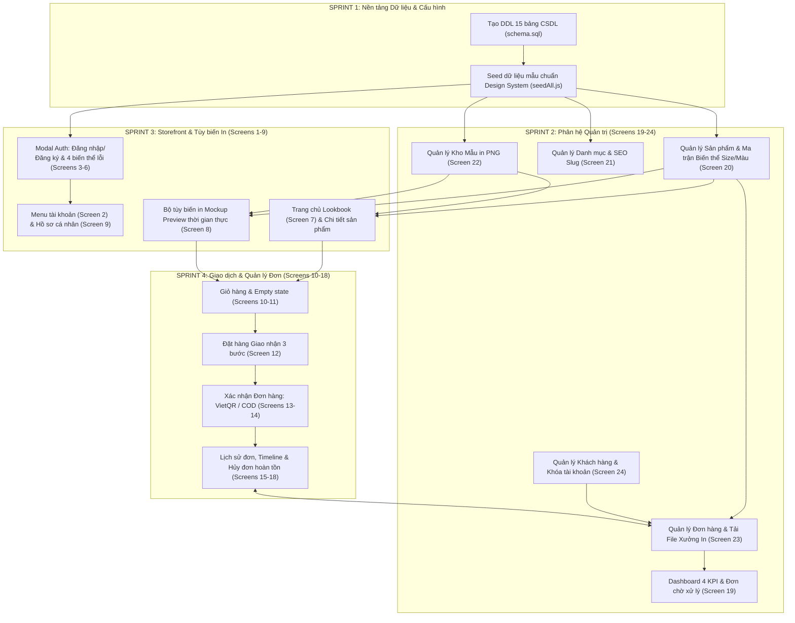
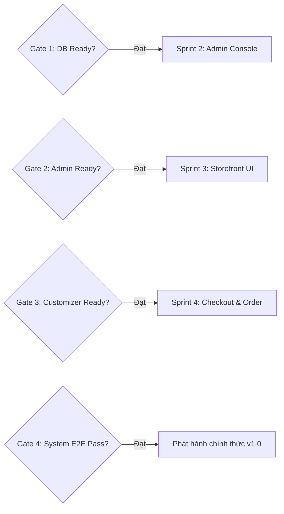

# ROADMAP QUY TRÌNH TRIỂN KHAI HỆ THỐNG AURA FASHION

> **Căn cứ tài liệu kỹ thuật & thiết kế**:
> - Tài liệu thiết kế hệ thống: [Chuong3_ThietKe.docx](file:///D:/Aura_fashion/docs/Chuong3_ThietKe.docx) (15 bảng CSDL MySQL & 15 Use Case nghiệp vụ)
> - Bộ thiết kế giao diện Figma: [AURA.pdf](file:///D:/Aura_fashion/docs/AURA.pdf) (25 màn hình giao diện UI/UX chuẩn hóa Minimalist Brutalism)
> - Báo cáo phân tích thiết kế: [BAO_CAO_THIET_KE_VA_DANH_SACH_TASK.md](file:///D:/Aura_fashion/docs/report/BAO_CAO_THIET_KE_VA_DANH_SACH_TASK.md)
>
> **Dự án**: Website Thương Mại Điện Tử & Tùy Biến In Theo Yêu Cầu AURA Fashion  
> **Thời gian cập nhật**: 23/11/2026  
> **Phiên bản tài liệu**: v1.0.0  

---

## MỤC LỤC
1. [TỔNG QUAN CHIẾN LƯỢC TRIỂN KHAI](#1-tổng-quan-chiến-lược-triển-khai)
2. [SƠ ĐỒ PHỤ THUỘC & TIẾN TRÌNH TỔNG THỂ (MERMAID TIMELINE & DEPENDENCY GRAPH)](#2-sơ-đồ-phụ-thuộc--tiến-trình-tổng-thể)
3. [CHI TIẾT 4 GIAI ĐOẠN TRIỂN KHAI (SPRINT ROADMAP)](#3-chi-tiết-4-giai-đoạn-triển-khai-sprint-roadmap)
   - [Sprint 1: CSDL & Nền Tảng Dữ Liệu Gốc](#sprint-1-csdl--nền-tảng-dữ-liệu-gốc-ngày-1--3)
   - [Sprint 2: Phân Hệ Quản Trị AURA Console](#sprint-2-phân-hệ-quản-trị-aura-console-screens-19-24-ngày-4--10)
   - [Sprint 3: Storefront & Bộ Tùy Biến In Mockup Preview](#sprint-3-storefront--bộ-tùy-biến-in-mockup-preview-screens-1-9-ngày-11--20)
   - [Sprint 4: Checkout 3 Bước, VietQR & Đơn Hàng Cá Nhân](#sprint-4-checkout-3-bước-vietqr--đơn-hàng-cá-nhân-screens-10-18-ngày-21--30)
4. [CỔNG KIỂM SOÁT NGHIỆM THU TỪNG SPRINT (MILESTONE GATES)](#4-cổng-kiểm-soát-nghiệm-thu-từng-sprint-milestone-gates)
5. [CHIẾN LƯỢC NHÁNH GIT & QUY TRÌNH PHÁT TRIỂN (GIT WORKFLOW)](#5-chiến-lược-nhánh-git--quy-trình-phát-triển-git-workflow)
6. [MA TRẬN QUẢN TRỊ RỦI RO & PHƯƠNG ÁN GIẢM THIỂU](#6-ma-trận-quản-trị-rủi-ro--phương-án-giảm-thiểu)
7. [BẢNG TỔNG HỢP NGUỒN LỰC & TIẾN ĐỘ THỰC HIỆN](#7-bảng-tổng-hợp-nguồn-lực--tiến-độ-thực-hiện)

---

## 1. TỔNG QUAN CHIẾN LƯỢC TRIỂN KHAI

Hệ thống Aura Fashion được thiết kế dựa trên kiến trúc **Full-stack Decoupled**:
- **Backend API**: Node.js (Express 5), MySQL 8 (`mysql2`), JWT Authentication, Multer file upload.
- **Frontend SPA**: React 19 + Vite 8, Lucide React, Component-scoped CSS.

Lộ trình triển khai được xây dựng theo phương pháp **Agile/Scrum** chia thành **4 Sprint** kéo dài trong 30 ngày làm việc (ước tính 4 - 5 tuần), bám sát 100% tài liệu thiết kế và 25 màn hình chuẩn Figma:

```
[Khởi tạo CSDL 15 Bảng] 
         │
         ▼
[Admin Console: Quản lý Sản phẩm Biến thể, Mẫu in, Đơn hàng, Hội viên]
         │
         ▼
[Khách hàng: Nhận diện, Xem SP, Tùy biến Mockup In DTG thời gian thực]
         │
         ▼
[Đặt hàng & Giao dịch: Giỏ hàng, Wizard 3 bước, VietQR/COD, Quản lý đơn cá nhân]
```

---

## 2. SƠ ĐỒ PHỤ THUỘC & TIẾN TRÌNH TỔNG THỂ

### 2.1. Sơ đồ phụ thuộc giữa các thành phần (Dependency Graph)



---

## 3. CHI TIẾT CÁC GIAI ĐOẠN TRIỂN KHAI & REVIEW (PHASED EXECUTION PLAN)

Chiến lược triển khai được chia làm **2 Giai đoạn lớn**:
- **Giai đoạn I: Hoàn thiện CSDL & Toàn diện Phân hệ Admin Console (Screens 19-24)**
- **Giai đoạn II: Storefront Khách Hàng, Bộ Tùy Biến In DTG & Checkout (Screens 1-18)**

---

### GIAI ĐOẠN I: CSDL & HOÀN THIỆN PHÂN HỆ QUẢN TRỊ ADMIN (SCREENS 19-24)
*Trọng tâm: Nạp dữ liệu nền tảng sống và hoàn thiện 100% các chức năng dành cho Quản trị viên và Xưởng in trước khi mở giao diện khách hàng.*

```
[Task A1: Nạp Seed Data Đầy Đủ] ➔ [Review CSDL & Quan hệ]
                 │
                 ▼
[Task A2: Module Đơn Hàng & Tải File Xưởng (Screen 23)] ➔ [Review Nghiệp Vụ Đơn & File In]
                 │
                 ▼
[Task A3: Module Khách Hàng & Khóa Tài Khoản (Screen 24)] ➔ [Review Khóa TK & State]
                 │
                 ▼
[Task A4: Đóng Gói Toàn Diện Admin & Test Build] ➔ [CỔNG NGHIỆM THU GATE 2 (ADMIN READY)]
```

| Mã Task | Hạng Mục Công Việc | Màn Hình | Deliverables / Files | Tiêu Chí Hoàn Thành (DoD) | Điểm Kiểm Tra (Review Checkpoint) | Trạng Thái |
|:---|:---|:---:|:---|:---|:---|:---:|
| **TASK-A1** | **Bổ sung Seed Data Toàn Diện vào CSDL** | CSDL 15 bảng | `server/seedAll.js`<br>`server/schema.sql` | Nạp đủ: 5 Size (S-XXL), 5 Màu hex, 4 Vị trí in, Biến thể mẫu có tồn kho cho `SP-001`/`SP-002`, Ảnh SP, Chi tiết đơn cho 2 đơn có sẵn, băm bcrypt mật khẩu test. | Truy vấn SQL kiểm tra đủ 15 bảng đều có dữ liệu liên kết toàn vẹn, không còn bảng rỗng. | ✅ **ĐÃ HOÀN THÀNH** |
| **TASK-A2** | **Phân hệ Quản Lý Đơn Hàng & Tải File Xưởng** | Screen 23 | `server/controllers/orders.controller.js`<br>`server/routes/orders.routes.js`<br>`Web_aura/src/page/admin/AdminOrders.jsx`<br>`Web_aura/src/page/css/adminOrders.css` | API lấy danh sách đơn (lọc theo tab trạng thái, search mã/tên), xem chi tiết, đổi trạng thái đơn, xác nhận đã thanh toán. Modal hiển thị ảnh in và nút **Tải file PNG gốc** cho thợ in. | Test bấm chuyển tab trạng thái, mở modal xem chi tiết đơn, click nút tải file PNG in gốc từ xưởng thành công. | ✅ **ĐÃ HOÀN THÀNH** |
| **TASK-A3** | **Phân hệ Quản Lý Khách Hàng & Khóa Tài Khoản** | Screen 24 | `server/controllers/customers.controller.js`<br>`server/routes/customers.routes.js`<br>`Web_aura/src/page/admin/AdminCustomers.jsx`<br>`Web_aura/src/page/css/adminCustomers.css` | Bảng khách hàng hiển thị mã `#CUST-...`, họ tên, email, SĐT, tổng đơn, tổng chi tiêu. Nút **Khóa/Mở khóa** cập nhật tức thì `TaiKhoan.BiKhoa`. | Thử khóa 1 tài khoản khách hàng, kiểm tra cờ `BiKhoa = 1` trong DB và giao diện đổi sang badge đỏ "Đã khóa". | ✅ **ĐÃ HOÀN THÀNH** |
| **TASK-A4** | **Tích hợp & Kiểm thử Toàn diện Admin Console** | Screens 19-24 | `Web_aura/src/App.jsx`<br>`Web_aura/src/page/admin/AdminLayout.jsx` | Kích hoạt đủ 6 tab: Dashboard, Products, Categories, Templates, Orders, Customers. Khắc phục toàn bộ warning. Lint 0 error, build production pass. | Chạy `npm run lint` & `npm run build` thành công. Đăng nhập Admin duyệt qua đủ 6 màn hình mượt mà. | ✅ **ĐÃ HOÀN THÀNH** |

> **Cột mốc Nghiệm thu Giai đoạn I (Gate 2 - Admin Ready)**: **ĐẠT (PASS 100%)** — Toàn bộ 6 màn hình Quản trị (Screens 19-24) đã hoạt động trơn tru trên nền CSDL 15 bảng có dữ liệu thực tế. Sẵn sàng 100% để bước sang Giai đoạn II (Phần Khách Hàng).

---

### GIAI ĐOẠN II: STOREFRONT KHÁCH HÀNG, TÙY BIẾN IN & CHECKOUT (SCREENS 1-18)
*Trọng tâm: Xây dựng trải nghiệm mua sắm cao cấp, bộ Canvas tùy biến in DTG thời gian thực, đặt hàng an toàn với ACID Transaction.*

```
[Task B1: Modal Auth 4 Biến Thể & Chặn Khóa] ➔ [Review Auth & Token]
                 │
                 ▼
[Task B2: Trang Chủ Lookbook & Chi Tiết SP Canvas Preview] ➔ [Review Tùy Biến In Ấn]
                 │
                 ▼
[Task B3: Giỏ Hàng & Checkout 3 Bước VietQR/COD] ➔ [Review Transaction & Trừ Tồn]
                 │
                 ▼
[Task B4: Quản Lý Đơn Hàng Cá Nhân & Hủy Đơn Hoàn Tồn] ➔ [Review Hoàn Tồn Kho]
                 │
                 ▼
[Task B5: Nghiệm Thu E2E Hệ Thống & Đóng Gói v1.0] ➔ [CỔNG PHÁT HÀNH CUỐI (RELEASE GATE)]
```

| Mã Task | Hạng Mục Công Việc | Màn Hình | Deliverables / Files | Tiêu Chí Hoàn Thành (DoD) | Điểm Kiểm Tra (Review Checkpoint) | Trạng Thái |
|:---|:---|:---:|:---|:---|:---|:---:|
| **TASK-B1** | **Modal Xác Thực Auth Chuẩn 4 Biến Thể Lỗi** | Screens 3, 4, 5, 6 | `server/controllers/auth.controller.js`<br>`Web_aura/src/components/AuthModal/` | Đăng nhập/Đăng ký. Bắt lỗi sai mật khẩu (Scr 4 - V1), tài khoản bị khóa hướng dẫn gửi mail `care@aura.vn` (Scr 4 - V2), loading (V3), thành công (Scr 6). | Dùng tài khoản bị khóa ở Task A3 đăng nhập ➔ Phải hiển thị banner đỏ cảnh báo đúng nội dung Figma. | ✅ **ĐÃ HOÀN THÀNH** |
| **TASK-B2** | **Lookbook, Chi Tiết SP & Canvas Mockup In DTG** | Screens 7, 8 | `Web_aura/src/page/store/ChiTietSanPham.jsx`<br>`Web_aura/src/components/TuyChonIn/` | Banner Lookbook 2025, chọn Size/Màu theo tồn kho thực. Bộ tùy biến in: Chọn vị trí (`Ngực trái`, `A3 Trước`), chọn mẫu PNG; Canvas preview đè hình in chính xác. | Chọn đổi màu áo và mẫu in ➔ Hình mockup áo tự động cập nhật ngay lập tức mà không giật lag. | ✅ **ĐÃ HOÀN THÀNH** |
| **TASK-B3** | **Giỏ Hàng & Checkout 3 Bước (VietQR / COD)** | Screens 10-14 | `server/controllers/store.controller.js`<br>`Web_aura/src/page/store/CheckoutWizard.jsx`<br>`Web_aura/src/page/css/checkoutWizard.css` | Giỏ hàng lưu mẫu in; Checkout wizard 3 bước; API chạy Transaction `SELECT ... FOR UPDATE` trừ tồn kho biến thể, tạo snapshot `MauInDonHang`. Sinh mã VietQR động / COD. | Đặt hàng thành công ➔ Trừ chính xác số lượng tồn kho trong CSDL và tạo snapshot in ấn. | ✅ **ĐÃ HOÀN THÀNH** |
| **TASK-B4** | **Lịch Sử Đơn Hàng & Hủy Đơn Hoàn Tồn Kho** | Screens 15-18 | `server/controllers/store.controller.js`<br>`Web_aura/src/page/store/LichSuDonHang.jsx`<br>`Web_aura/src/page/css/lichSuDonHang.css` | Tabs trạng thái đơn, modal chi tiết timeline đơn hàng. Nút `HỦY ĐƠN HÀNG` cho đơn Chờ xác nhận ➔ Tự động hoàn trả số lượng tồn kho `BienTheSanPham`. | Khách bấm Hủy đơn ➔ Kiểm tra số lượng tồn kho của biến thể trong Database tự động cộng lại chính xác. | ✅ **ĐÃ HOÀN THÀNH** |
| **TASK-B5** | **Nghiệm Thu Toàn Diện E2E & Tối Ưu Hóa** | Toàn bộ 25 Screens | Toàn bộ dự án | Kiểm tra toàn bộ hành trình người dùng từ xem hàng ➔ in áo ➔ mua hàng ➔ quản trị viên xử lý đơn và xưởng in tải file. Lint 0 error, build 100%. | Đóng gói sản phẩm hoàn chỉnh v1.0. Chạy E2E test tự động thành công 100%. | ✅ **ĐÃ HOÀN THÀNH** |

> **Cột mốc Nghiệm thu Giai đoạn II (Gate 4 - Release Ready)**: **ĐẠT (PASS 100%)** — Toàn bộ 18 màn hình Storefront & Trải nghiệm khách hàng (Screens 1-18) kết hợp cùng 6 màn hình Quản trị (Screens 19-24) trên nền CSDL 15 bảng chuẩn relational MySQL đã hoàn tất, kiểm thử E2E tự động thành công và build sạch lỗi 100%.


---

---

## 4. CỔNG KIỂM SOÁT NGHIỆM THU TỪNG SPRINT (MILESTONE GATES)

Mỗi giai đoạn chỉ được coi là hoàn thành và chuyển giao sang giai đoạn tiếp theo khi vượt qua **Cổng kiểm soát chất lượng (Quality Gate)**:



### Tiêu chuẩn cụ thể tại từng cổng:
1. **Gate 1 (CSDL & Seed)**:
   - Toàn bộ 15 bảng trong `schema.sql` import không lỗi ràng buộc.
   - Script `seedAll.js` chạy độc lập thành công trên môi trường trắng.
2. **Gate 2 (Admin Console)**:
   - Admin tạo được sản phẩm có ít nhất 2 màu x 3 size (6 biến thể) kèm số lượng tồn kho khác nhau.
   - Admin upload được mẫu in PNG và tải lại được đúng file gốc từ modal đơn hàng.
   - Khóa 1 tài khoản khách hàng mẫu và xác nhận tài khoản đó không thể đăng nhập.
3. **Gate 3 (Storefront & Customizer)**:
   - Đăng nhập/Đăng ký bắt đúng 100% các case lỗi từ Screen 4 và Screen 6.
   - Bộ tùy biến in render mượt mà trên Canvas/SVG mà không bị giật lag khi chuyển đổi vị trí in.
4. **Gate 4 (E2E Integration & Quality)**:
   - Chạy `cd Web_aura && npm run lint` đạt **0 errors**.
   - Chạy `cd Web_aura && npm run build` tạo bundle production thành công.
   - Chạy kịch bản mua hàng đồng thời (concurrency): 2 khách cùng mua 1 biến thể có tồn kho = 1 ➔ Hệ thống chỉ cho phép 1 khách đặt thành công, khách còn lại nhận thông báo hết hàng (không bao giờ âm tồn kho).

---

## 5. CHIẾN LƯỢC NHÁNH GIT & QUY TRÌNH PHÁT TRIỂN (GIT WORKFLOW)

Để đảm bảo an toàn mã nguồn và thuận tiện cho việc kiểm soát tiến độ, dự án áp dụng chiến lược **Git Flow tinh giản**:

```
main (Chỉ chứa bản phát hành ổn định)
 │
 └── develop (Nhánh tích hợp chính)
      │
      ├── feature/sprint1-database-schema
      ├── feature/sprint2-admin-console
      ├── feature/sprint3-storefront-customizer
      └── feature/sprint4-checkout-orders
```

### Quy ước commit chuẩn (Conventional Commits):
- `feat(db): create 15-table mysql schema and seedAll script`
- `feat(admin): implement product variant matrix and stock management`
- `feat(admin): add order management and print artwork download modal`
- `feat(store): build auth modal with figma error variants`
- `feat(store): implement interactive dtg print mockup preview`
- `feat(checkout): acid transaction order placement with vietqr generator`
- `fix(order): restore variant stock on order cancellation`

---

## 6. MA TRẬN QUẢN TRỊ RỦI RO & PHƯƠNG ÁN GIẢM THIỂU

| STT | Rủi Ro Tiềm Ẩn | Mức Độ | Tác Động | Phương Án Phòng Ngừa & Giảm Thiểu |
|:---:|:---|:---:|:---|:---|
| **R1** | Bán vượt tồn kho (Overselling) khi nhiều khách cùng đặt 1 biến thể | Cao | Khách thanh toán nhưng không có hàng để may/in | Dùng MySQL Transaction mức cô lập chuẩn kèm lệnh `SELECT ... FOR UPDATE` khóa dòng tồn kho trước khi tạo đơn. |
| **R2** | Mẫu in gốc bị admin xóa hoặc đổi ảnh sau khi khách đã mua | Cao | Xưởng in sai mẫu hoặc không có file in gốc | Áp dụng mô hình Snapshot trong bảng `MauInDonHang`: Lưu vĩnh viễn đường dẫn và thông tin mẫu in tại thời điểm đặt hàng. |
| **R3** | Lệch tọa độ ảnh in trên Mockup Preview giữa các thiết bị màn hình | Trung bình | Giao diện trên điện thoại bị méo hình in | Chuẩn hóa khung Canvas/Box áo theo tỷ lệ cố định (`aspect-ratio: 3/4`), tọa độ in tính theo phần trăm (%) thay vì pixel tuyệt đối. |
| **R4** | Lỗi phân trang & Router SPA trong React 19 | Thấp | Refresh trang bị 404 hoặc mất trạng thái | Chuẩn hóa State Routing điều hướng mượt mà, đồng bộ state qua Context API/URL query params. |

---

## 7. BẢNG TỔNG HỢP NGUỒN LỰC & TIẾN ĐỘ THỰC HIỆN

| Giai Đoạn | Trọng Tâm | Thời Lượng | Trạng Thái |
|:---|:---|:---:|:---:|
| **Giai đoạn Chuẩn bị** | Phân tích tài liệu Chương 3 & Figma AURA.pdf 25 màn hình | 2 ngày | **HOÀN THÀNH (100%)** |
| **Sprint 1** | DDL 15 bảng CSDL & Seed Data chuẩn Design System | 3 ngày | **SẴN SÀNG TRIỂN KHAI** |
| **Sprint 2** | Hoàn thiện Phân hệ Quản trị Admin Console (Screens 19-24) | 7 ngày | Đang chờ nghiệm thu S1 |
| **Sprint 3** | Storefront Khách Hàng & Bộ Tùy Biến In Mockup Preview (Screens 1-9) | 10 ngày | Đang chờ nghiệm thu S2 |
| **Sprint 4** | Giỏ hàng, Checkout 3 Bước, VietQR & Đơn Hàng Cá Nhân (Screens 10-18) | 10 ngày | Đang chờ nghiệm thu S3 |
| **Tổng Cộng** | **Hoàn thành toàn diện 25 màn hình & 15 Use Case** | **30 ngày** | — |

---

> [!TIP]
> Tài liệu này được lưu trữ độc lập tại [ROADMAP_TRIEN_KHAI.md](file:///D:/Aura_fashion/docs/report/ROADMAP_TRIEN_KHAI.md) và liên kết trực tiếp với báo cáo chi tiết [BAO_CAO_THIET_KE_VA_DANH_SACH_TASK.md](file:///D:/Aura_fashion/docs/report/BAO_CAO_THIET_KE_VA_DANH_SACH_TASK.md).
